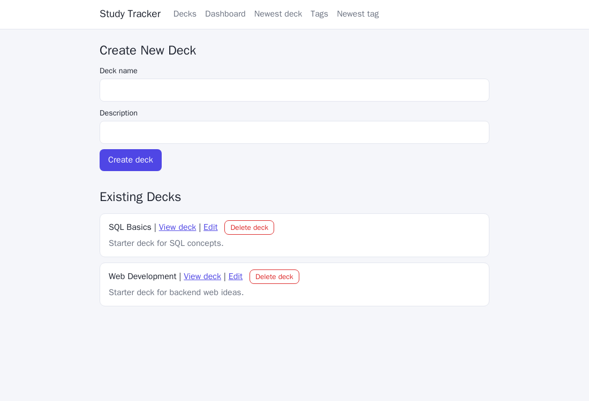
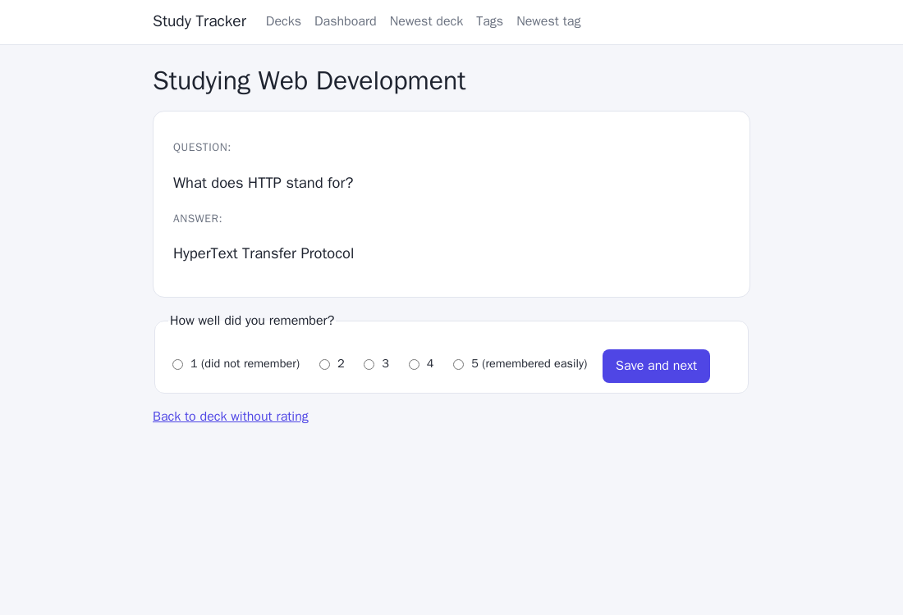
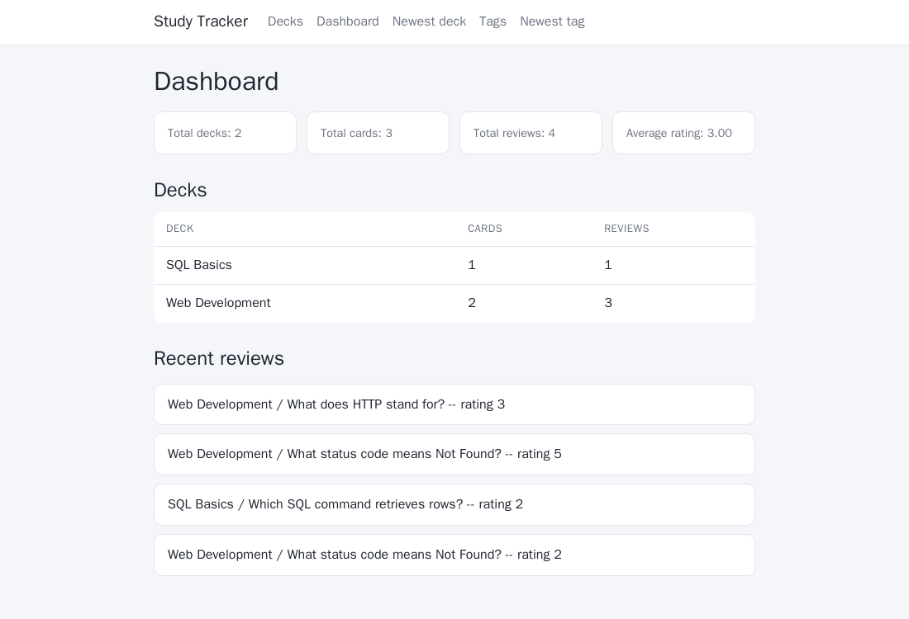

# Study Tracker

A flashcard app for organising what you're learning. Create decks and cards, tag them, study with a spaced-repetition-style review loop, and see progress on a dashboard.

Built as a course project to practise relational database design and server-rendered web apps.


## Screenshots

| Decks | Study | Dashboard |
|---|---|---|
|  |  |  |

## Features

- **Decks and cards**: full create / edit / delete
- **Tags**: many-to-many tagging of cards
- **Study mode**: shows the least recently reviewed card first (never-reviewed cards come first), then you rate your recall from 1 to 5
- **Dashboard**: totals, average rating, per-deck stats and recent reviews

## Stack

- Python 3.12, [FastAPI](https://fastapi.tiangolo.com/), Jinja2 templates
- PostgreSQL 18 via [psycopg 3](https://www.psycopg.org/psycopg3/) with parameterised SQL (no ORM)
- Plain SQL migrations applied on start-up (`app/migrate.py`)
- Docker / Docker Compose

## Run it

```sh
docker compose up --build
```

Open <http://localhost:8000>. Migrations (including a small demo dataset) run automatically.

Configuration (all optional):

| Variable | Default | Purpose |
|---|---|---|
| `POSTGRES_PASSWORD` | `postgres` | Database password (set it for anything non-local) |
| `DEV_RELOAD` | `1` in compose | Enables uvicorn auto-reload |

## Project layout

```
app/            FastAPI app, DB access, migration runner, templates
migrations/     Numbered SQL files, applied in order and tracked in schema_migrations
design/         Database design: subject analysis, ER diagram, design rationale
```

See [design/](design/) for the data model and the reasoning behind it.

## Known limitations

- No authentication or CSRF protection, so it is intended as a single-user local app
- The migration runner splits statements on `;` and is meant for simple SQL files
- One DB connection per request (no pooling)
