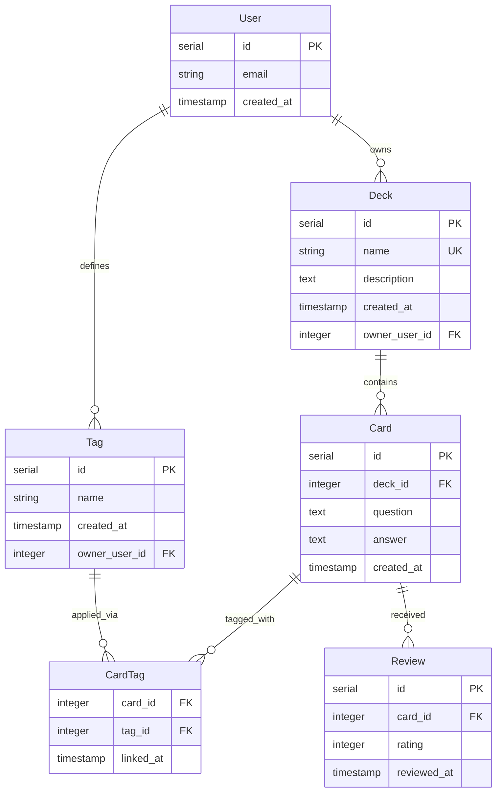

# Entity–relationship diagram (study tracker)

This diagram reflects the domain described in [subject-analysis.md](subject-analysis.md) and the tables in [migrations/](../migrations/). Sentences that describe only the teaching database use **as-built** or the `*` legend; anything marked **`†`** or called a **proposal** is not in the repo migrations.

**Legend**

- `*` — Matches the current teaching schema (or a relationship that holds without `User`).
- `†` — Deliberate proposal (tenancy, per-owner uniqueness, link metadata, safer FK deletes in prose). Omit **User**, `owner_user_id`, `linked_at`, and per-owner uniqueness rules to recover the repo schema.

### Scope (what this diagram includes and excludes)

- **In scope:** The five domain entities from the subject analysis — **Deck**, **Card**, **Tag**, the card–tag association (**CardTag**, table `card_tags`), and **Review** (table `reviews`). **Proposal:** **User** and ownership FKs (`†`), shown as a union with the as-built model.
- **Out of scope:** **Roles** (*Learner*, *System*) are not entity boxes. **System** migration bookkeeping (`schema_migrations` in [app/migrate.py](../app/migrate.py)) is operational, not part of the flashcard vocabulary ER model.
- **Terminology:** Physical table `card_tags` = associative entity **CardTag** in this document and the Mermaid figure.

---

## As-built + proposed union (diagram)

---

## Cardinality (read as one sentence each)

| Line | One-sentence read |
|------|-------------------|
| **User → Deck** † | Each user may own many decks; each deck in the proposed model belongs to exactly one user. |
| **User → Tag** † | Each user may define many tags; each tag in the proposed model belongs to exactly one user. |
| **Deck → Card** * | Each deck contains zero or more cards; each card belongs to exactly one deck. |
| **Card → CardTag** * | Each card may participate in zero or more tag links; each link row refers to exactly one card. |
| **Tag → CardTag** * | Each tag may appear on zero or more cards via link rows; each link row refers to exactly one tag. |
| **Card → Review** * | Each card may have zero or more review rows over time; each review belongs to exactly one card. |

Together, **Card** and **Tag** relate **many-to-many** through the explicit associative entity **CardTag** (visible structure in the diagram, not only a named line). **CardTag** has a composite primary key on `(card_id, tag_id)` in the current schema. **Card** and **Review** relate **one-to-many**: each `reviews` row carries one rating event for one card; deck-level aggregates follow **Deck → Card → Review**.

---

## Attributes (* vs †)

Use this table to see what matches [migrations/](../migrations/) versus what is proposal-only. The Mermaid figure shows the **union** (teaching schema plus proposed columns) so tenancy and link metadata stay visible in one picture.

| Entity | Attribute | In current migrations | Notes |
|--------|-----------|----------------------|--------|
| **User** | `id`, `email`, `created_at` | No † | Entire entity is a proposal; `email` is one possible natural key. |
| **Deck** | `id` | Yes * | |
| **Deck** | `name` | Yes * | `UNIQUE` globally today; with **User**, uniqueness would normally be **per owner** †. |
| **Deck** | `description` | Yes * | Nullable. |
| **Deck** | `created_at` | Yes * | |
| **Deck** | `owner_user_id` | No † | FK to **User**; ownership line in the diagram. |
| **Card** | `id`, `deck_id`, `question`, `answer`, `created_at` | Yes * | `deck_id` references **Deck** with `ON DELETE CASCADE`. |
| **Tag** | `id`, `name`, `created_at` | Yes * | |
| **Tag** | `owner_user_id` | No † | FK to **User**; scopes tags per account in the proposal. |
| **Tag** | unique `name` | No * | Not enforced today; proposal adds **unique (`owner_user_id`, `name`)** †. |
| **CardTag** | `card_id`, `tag_id` | Yes * | Composite PK; FKs to **Card** and **Tag** (default `ON DELETE` in DB). |
| **CardTag** | `linked_at` | No † | Relationship attribute; supports audit or ordering of tag application. |
| **Review** | `id`, `card_id`, `rating`, `reviewed_at` | Yes * | `card_id` references **Card** with `ON DELETE CASCADE`. `rating` is an integer with **`CHECK` between 1 and 5** inclusive. `reviewed_at` defaults to the row insert time. |
| **Review** | `user_id` / reviewer | No † | Not in migrations; reviews are anonymous in the teaching schema. |

---

## Relationship attribute

| Structure | Attribute | In current schema? | Role |
|-----------|-----------|--------------------|------|
| **CardTag** | `(card_id, tag_id)` | Yes * | Composite identifier; uniquely identifies one card–tag pair (duplicate application is a no-op at the app layer). |
| **CardTag** | `linked_at` | No † | When the tag was attached; supports ordering, audit, or “recently tagged” without inferring from other tables. |
| **Review** | `id` (surrogate PK) | Yes * | One row per rating event; supports many reviews per card over time. |
| **Review** | `reviewed_at` | Yes * | When the rating was recorded; supports “most recent review” without inferring from other tables. |

---

## Testing the design against these queries

Cross-check against **Likely application queries** in [subject-analysis.md](subject-analysis.md): for each question, the entities and paths below must be enough to express the query. (Whether the app implements it is separate.)

| Query | Entities / path | As-built notes |
|-------|-----------------|----------------|
| List all decks A–Z | **Deck** only | Order by `Deck.name`. |
| Load the “newest” deck | **Deck** only | **Reconstructed from app:** the route orders by `id DESC`. The schema also has `created_at`; “newest” could mean max `id` or max `created_at` — a product should pick one rule. Both attributes sit on **Deck** in the diagram. |
| All cards that have a given tag (any deck) | **Tag** → **CardTag** → **Card**; join **Deck** if deck title or filtering by owner is needed | **As-built:** fully supported by relationships. **Not implemented** in the current UI/routes. If **User** (`†`) exists, filter decks (or cards via deck) by owner. |
| Review count per card | **Card** → **Review** | Aggregate `COUNT(*)` on **Review** grouped by `card_id`. |
| Most recent review for a card | **Card** → **Review** | Filter by `card_id`; order by `reviewed_at` descending or take `MAX(reviewed_at)`. |
| Average rating per deck | **Deck** → **Card** → **Review** | Join cards to reviews; `AVG(rating)` grouped by deck (or deck id). **Not on dashboard** (overall average only there). |
| Cards never reviewed | **Card** left join **Review** | Rows with no matching review, e.g. `LEFT JOIN reviews ON reviews.card_id = cards.id WHERE reviews.id IS NULL`, or `NOT EXISTS` equivalent. **Partially in app:** deck detail shows “not reviewed yet” per card. |
| Site-wide totals and per-deck card/review counts | **Deck**, **Card**, **Review** | **Implemented** at `GET /dashboard`: global counts; per-deck counts from separate `GROUP BY` queries merged in the app so empty decks stay visible. |
| Ten most recent reviews | **Review** → **Card** → **Deck** | **Implemented** at `GET /dashboard` (`ORDER BY reviewed_at DESC LIMIT 10`). |

---

## Proposal annotations (divergences from [migrations/](../migrations/))

- **`User` entity and `owner_user_id` / `defines`** † — Addresses the subject-analysis gap: there is no `user_id` today; decks and tags are globally shared.
- **`Deck.name` uniqueness** * vs † — Today: **global** `UNIQUE` on `decks.name`. With users: natural rule is **unique deck name per owner**, not globally (annotate on entity).
- **`Tag.name` uniqueness** * vs † — Today: **no** `UNIQUE` on `tags.name`. Proposal: **unique tag name per owner** (composite unique with `owner_user_id`).
- **`CardTag.linked_at`** † — Not in `card_tags`; optional relationship metadata for a real product.
- **Referential actions on `card_tags`** — Today: FKs to `cards` and `tags` use the default (`NO ACTION`). The note flags risk when deleting decks/cards with existing links; a production design often adds **`ON DELETE CASCADE`** on `card_tags.card_id` (and consistent rules on `tag_id`) so lines in the diagram do not imply orphan links. That is a migration detail rather than a new box on the ER diagram.
- **`reviews` without `user_id`** * — As-built: ratings are not tied to a **User** row; the **User** box remains **†** only. A production design could add `reviewer_user_id` or similar.

---

## Read-aloud check against [subject-analysis.md](subject-analysis.md)

1. **“Deck contains many cards; delete cascades to cards in the DB.”** — The **Deck → Card** line matches; cascade is documented on `Card.deck_id` in migrations, not as a separate shape.
2. **“Card and tag are many-to-many through an association.”** — **CardTag** is drawn as its own entity; **Card → CardTag** and **Tag → CardTag** are the two legs.
3. **“Learner is implied, not stored.”** — In the teaching schema there is **no** `User` row; the **User** box and ownership lines are **†** and labeled as proposals.
4. **Connections in the app (card–deck join, card–tag join, available tags)** — All are implied by these relationships; no extra edges are required for read paths.
5. **“Each review belongs to one card; deleting the card drops its reviews.”** — **Card → Review** uses `ON DELETE CASCADE` on `reviews.card_id` in migrations; deleting a **Deck** still cascades to **Card**, which in turn removes dependent reviews.
6. **Review analytics paths** — Counts, recency, and deck-level rollups are expressible with **Review** joined to **Card** (and **Deck** where needed). The **dashboard** route exposes site-wide totals, per-deck card/review counts, overall average rating, and recent reviews; deck detail still handles per-card averages and “not reviewed yet.”

If you strip every **†** field and the **User** entity, the diagram describes only **Deck, Card, Tag, CardTag, Review** as in the current SQL—still with **CardTag** visible as the many-to-many bridge and **Review** as the one-to-many child of **Card**.