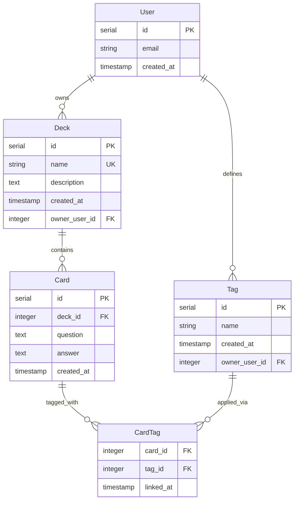

# Entity–relationship diagram (study tracker)

This diagram reflects the domain described in [subject-analysis.md](subject-analysis.md) and the tables in [migrations/](../migrations/). The Mermaid figure shows a target union: everything that exists today plus columns and entities a production model would typically add. The Attributes (* vs †) table and cardinality rows spell out what matches migrations (`*`) versus what is proposal only (`†`).

**Legend**

- `*` — Matches the current teaching schema (or a relationship that holds without `User`).
- `†` — Deliberate proposal (tenancy, per-owner uniqueness, link metadata, safer FK deletes in prose). Omit **User**, `owner_user_id`, `linked_at`, and per-owner uniqueness rules to recover the repo schema.

---

## Diagram

---

## Cardinality (read as one sentence each)

| Line | One-sentence read |
|------|-------------------|
| **User → Deck** † | Each user may own many decks; each deck in the proposed model belongs to exactly one user. |
| **User → Tag** † | Each user may define many tags; each tag in the proposed model belongs to exactly one user. |
| **Deck → Card** * | Each deck contains zero or more cards; each card belongs to exactly one deck. |
| **Card → CardTag** * | Each card may participate in zero or more tag links; each link row refers to exactly one card. |
| **Tag → CardTag** * | Each tag may appear on zero or more cards via link rows; each link row refers to exactly one tag. |

Together, **Card** and **Tag** relate **many-to-many** through the explicit associative entity **CardTag** (visible structure in the diagram, not only a named line). **CardTag** has a composite primary key on `(card_id, tag_id)` in the current schema.

---

## Attributes (* vs †)

Use this table to see what matches [migrations/](../migrations/) versus what is proposal-only. The Mermaid figure shows the **union** (teaching schema plus proposed columns) so tenancy and link metadata stay visible in one picture.

| Entity | Attribute | In current migrations | Notes |
|--------|-----------|----------------------|--------|
| **User** | `id`, `email`, `created_at` | No † | Entire entity is a proposal; `email` is one possible natural key. |
| **Deck** | `id` | Yes * | |
| **Deck** | `name` | Yes * | `UNIQUE` globally today; with **User**, uniqueness would normally be **per owner** †. |
| **Deck** | `description` | Yes * | Nullable. |
| **Deck** | `created_at` | Yes * | |
| **Deck** | `owner_user_id` | No † | FK to **User**; ownership line in the diagram. |
| **Card** | `id`, `deck_id`, `question`, `answer`, `created_at` | Yes * | `deck_id` references **Deck** with `ON DELETE CASCADE`. |
| **Tag** | `id`, `name`, `created_at` | Yes * | |
| **Tag** | `owner_user_id` | No † | FK to **User**; scopes tags per account in the proposal. |
| **Tag** | unique `name` | No * | Not enforced today; proposal adds **unique (`owner_user_id`, `name`)** †. |
| **CardTag** | `card_id`, `tag_id` | Yes * | Composite PK; FKs to **Card** and **Tag** (default `ON DELETE` in DB). |
| **CardTag** | `linked_at` | No † | Relationship attribute; supports audit or ordering of tag application. |

---

## Relationship attribute

| Structure | Attribute | In current schema? | Role |
|-----------|-----------|--------------------|------|
| **CardTag** | `(card_id, tag_id)` | Yes * | Composite identifier; uniquely identifies one card–tag pair (duplicate application is a no-op at the app layer). |
| **CardTag** | `linked_at` | No † | When the tag was attached; supports ordering, audit, or “recently tagged” without inferring from other tables. |

---

## Proposal annotations (divergences from [migrations/](../migrations/))

- **`User` entity and `owner_user_id` / `defines`** † — Addresses the subject-analysis gap: there is no `user_id` today; decks and tags are globally shared.
- **`Deck.name` uniqueness** * vs † — Today: **global** `UNIQUE` on `decks.name`. With users: natural rule is **unique deck name per owner**, not globally (annotate on entity).
- **`Tag.name` uniqueness** * vs † — Today: **no** `UNIQUE` on `tags.name`. Proposal: **unique tag name per owner** (composite unique with `owner_user_id`).
- **`CardTag.linked_at`** † — Not in `card_tags`; optional relationship metadata for a real product.
- **Referential actions on `card_tags`** — Today: FKs to `cards` and `tags` use the default (`NO ACTION`). The note flags risk when deleting decks/cards with existing links; a production design often adds **`ON DELETE CASCADE`** on `card_tags.card_id` (and consistent rules on `tag_id`) so lines in the diagram do not imply orphan links. That is a migration detail rather than a new box on the ER diagram.

---

## Read-aloud check against [subject-analysis.md](subject-analysis.md)

1. **“Deck contains many cards; delete cascades to cards in the DB.”** — The **Deck → Card** line matches; cascade is documented on `Card.deck_id` in migrations, not as a separate shape.
2. **“Card and tag are many-to-many through an association.”** — **CardTag** is drawn as its own entity; **Card → CardTag** and **Tag → CardTag** are the two legs.
3. **“Learner is implied, not stored.”** — In the teaching schema there is **no** `User` row; the **User** box and ownership lines are **†** and labeled as proposals.
4. **Connections in the app (card–deck join, card–tag join, available tags)** — All are implied by these relationships; no extra edges are required for read paths.

If you strip every **†** field and the **User** entity, the diagram describes only **Deck, Card, Tag, CardTag** as in the current SQL—still with **CardTag** visible as the many-to-many bridge.
